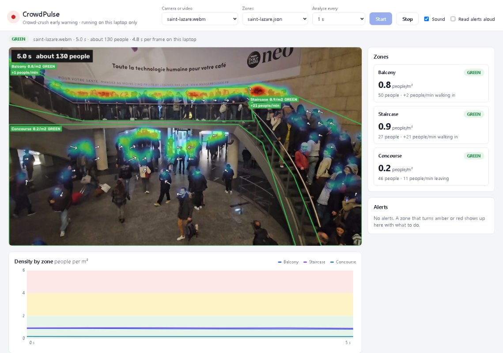

# CrowdPulse

Early warning for crowd crushes. CrowdPulse watches CCTV footage, works out how packed each part of a venue is
and which way people are moving, and flags where a crowd is building up before it becomes dangerous.

It was started after the crush outside M. Chinnaswamy Stadium, Bengaluru, on 4 June 2025, where 11 people died
during a victory celebration that drew far more people than the area could hold.

CrowdPulse counts people. It does not recognise anyone: no faces are detected, stored or compared.

## What works so far

- **Density map:** a crowd-counting model turns each frame into a map of how many people stand in each patch.
  The sum of the map is the head count.
- **Movement arrows:** dense optical flow shows which way each part of the crowd is moving. The camera's own
  movement (a hand-held phone panning, turning or zooming) is measured and removed first.
- **Zones and warnings:** named areas (a staircase, a gate, a canteen counter) with their floor area, so each
  gets a density in people per square metre and a warning level:

  | Level | People per m² | What it means |
  |---|---|---|
  | Green | under 2 | People move freely |
  | Amber | 2 to 4 | Crowded; people slow down and bump into each other |
  | Red | 4 and above | People can no longer choose their own path |
  | Critical | about 5 and above | Pressure can travel through the crowd; a crush can start |

- **Early warning:** each zone's inflow (people per minute crossing into it, found by moving every patch of the
  crowd along its arrow for 5 seconds) and its density trend give a countdown, "critical in about 6 minutes".
  A zone that people are pouring into turns amber or red before it is packed.

- **Local dashboard:** pick a video or the laptop's webcam and watch the analysis live in the browser: the
  annotated view, a card per zone, density over time, and alerts with what to do, a sound, and optionally a
  voice reading them aloud. It runs only on this laptop; nothing is sent anywhere.



## Run the dashboard

```bash
.venv\Scripts\python scripts\dashboard.py --open
```

It opens http://127.0.0.1:8765. Only this laptop can reach it: it listens on 127.0.0.1, refuses requests
addressed to any other host name, and takes commands only as JSON, so a web page in another tab cannot drive it.
Put your own videos in `data/videos/` and draw their zones with `scripts/draw_zones.py`; a zones file with the
same name as the video (`canteen.mp4`, `canteen.json`) is picked automatically. Each frame takes about 2-3 s on
a laptop CPU, so "Analyse every 2 s" keeps a live webcam closest to real time.

## Run it from the command line

Requires Python 3.12.

```bash
python -m venv .venv
.venv\Scripts\python -m pip install -r requirements.txt      # macOS/Linux: .venv/bin/python
.venv\Scripts\python scripts\get_model.py                     # downloads the model and checks its checksum

# one annotated frame, 60 seconds into the video
.venv\Scripts\python scripts\analyse.py data\samples\saint-lazare.webm --at 60

# an annotated clip from 40 s to 70 s, one analysed frame every 0.5 s
.venv\Scripts\python scripts\analyse.py data\samples\saint-lazare.webm --start 40 --end 70 --every 0.5

# the same with zones and warnings; also writes a .jsonl timeline of every zone's readings
.venv\Scripts\python scripts\analyse.py data\samples\saint-lazare.webm --zones data\zones\saint-lazare.json --start 40 --end 70

# draw zones on your own video by clicking (instructions print when it opens)
.venv\Scripts\python scripts\draw_zones.py path\to\your-video.mp4

# tests
.venv\Scripts\python -m pytest
```

Results go to `out/`. The sample videos are listed, with links, in [`data/samples/CREDITS.md`](data/samples/CREDITS.md).

## How it works

| File | What it does |
|---|---|
| `crowdpulse/density.py` | Runs the crowd model on a frame, in 512x512 tiles so people keep their real size |
| `crowdpulse/flow.py` | Measures crowd movement between two frames, after removing the camera's own motion |
| `crowdpulse/zones.py` | Loads zones; measures each zone's people, density and inflow |
| `crowdpulse/risk.py` | Follows each zone over time: warning level and minutes to critical |
| `crowdpulse/overlay.py` | Draws the heatmap, the arrows, the zones and the count |
| `crowdpulse/engine.py` | Video and webcam sources, and the analysis of each frame |
| `crowdpulse/alerts.py` | An alert with what to do each time a zone's level rises |
| `crowdpulse/server.py` | The local dashboard's web server (127.0.0.1 only) |
| `crowdpulse/web/` | The dashboard page |
| `scripts/dashboard.py` | Starts the dashboard |
| `scripts/analyse.py` | Annotates one frame or a clip of a video |
| `scripts/draw_zones.py` | Draw zones on a video frame by clicking |
| `scripts/get_model.py` | Downloads the model and verifies it |

## Known limits

- **Floor areas are estimates.** Density in people per m² is only as good as each zone's area; measure it on
  site where possible.
- **Distance from the camera.** Movement is measured in pixels, so far-away people walking slowly can fall under
  the "shuffling in place" cut-off. In the station sample this leaves the staircase's inflow a few people per
  minute low. Calibrating each camera (pixels per metre across the view) would remove it.
- **Inflow at the picture's edge.** The crowd just outside the picture is assumed to look like the crowd at its
  edge. A crowd that is different off screen, such as a queue just out of view, is not seen until it arrives.
- **Moving cameras.** Zones are drawn on fixed pixel positions. A fixed CCTV camera keeps them aligned; a hand-held
  sample clip drifts a little.

## Credits

- Crowd model: [DM-Count](https://github.com/cvlab-stonybrook/DM-Count) (Wang et al., NeurIPS 2020, MIT licence),
  UCF-QNRF weights, as the ONNX export in
  [mlboydaisuke/DM-Count-Crowd-OpenVINO](https://huggingface.co/mlboydaisuke/DM-Count-Crowd-OpenVINO) (MIT).
- Sample footage: Wikimedia Commons, CC BY-SA 4.0. Authors and links in `data/samples/CREDITS.md`.
