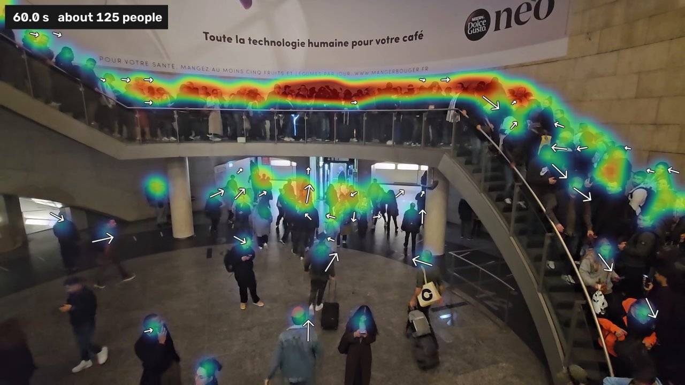

# CrowdPulse

Early warning for crowd crushes. CrowdPulse watches CCTV footage, works out how packed each part of a venue is
and which way people are moving, and flags where a crowd is building up before it becomes dangerous.

It was started after the crush outside M. Chinnaswamy Stadium, Bengaluru, on 4 June 2025, where 11 people died
during a victory celebration that drew far more people than the area could hold.

CrowdPulse counts people. It does not recognise anyone: no faces are detected, stored or compared.

## What works so far (day 1)

- **Density map:** a crowd-counting model turns each frame into a map of how many people stand in each patch.
  The sum of the map is the head count.
- **Movement arrows:** dense optical flow shows which way each part of the crowd is moving. The camera's own
  movement (a hand-held phone panning, turning or zooming) is measured and removed first.



## Run it

Requires Python 3.12.

```bash
python -m venv .venv
.venv\Scripts\python -m pip install -r requirements.txt      # macOS/Linux: .venv/bin/python
.venv\Scripts\python scripts\get_model.py                     # downloads the model and checks its checksum

# one annotated frame, 60 seconds into the video
.venv\Scripts\python scripts\analyse.py data\samples\saint-lazare.webm --at 60

# an annotated clip from 40 s to 70 s, one analysed frame every 0.5 s
.venv\Scripts\python scripts\analyse.py data\samples\saint-lazare.webm --start 40 --end 70 --every 0.5
```

Results go to `out/`. The sample videos are listed, with links, in [`data/samples/CREDITS.md`](data/samples/CREDITS.md).

## How it works

| File | What it does |
|---|---|
| `crowdpulse/density.py` | Runs the crowd model on a frame, in 512x512 tiles so people keep their real size |
| `crowdpulse/flow.py` | Measures crowd movement between two frames, after removing the camera's own motion |
| `crowdpulse/overlay.py` | Draws the heatmap, the arrows and the count |
| `scripts/analyse.py` | Annotates one frame or a clip of a video |
| `scripts/get_model.py` | Downloads the model and verifies it |

## Credits

- Crowd model: [DM-Count](https://github.com/cvlab-stonybrook/DM-Count) (Wang et al., NeurIPS 2020, MIT licence),
  UCF-QNRF weights, as the ONNX export in
  [mlboydaisuke/DM-Count-Crowd-OpenVINO](https://huggingface.co/mlboydaisuke/DM-Count-Crowd-OpenVINO) (MIT).
- Sample footage: Wikimedia Commons, CC BY-SA 4.0. Authors and links in `data/samples/CREDITS.md`.
