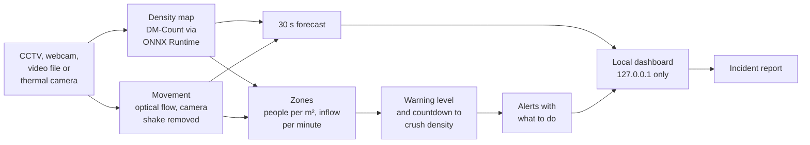

# CrowdPulse: crowd-crush early warning from ordinary CCTV

**One line:** CrowdPulse watches existing cameras, measures how tightly people are packed in each area and how
fast it is filling, and warns the control room minutes before a crowd becomes dangerous, with what to do about it.

## The problem

On 4 June 2025, during celebrations of Royal Challengers Bengaluru's first IPL title, a crowd crush at the gates
of Chinnaswamy Stadium in Bengaluru killed 11 people. Crushes like this build up over minutes, not seconds: more
people arrive at a bottleneck than it can let through, and the crowd in front of it packs tighter until people
can no longer move on their own. Crowd-safety guidance treats more than about 5 people per square metre in a
crowd as the danger zone.

The cameras are usually already there. What is missing is someone, or something, watching every feed and
noticing the build-up early enough to act: open another gate, hold people back, send stewards.

## What CrowdPulse does

- **Measures density from video.** A crowd-counting neural network (DM-Count) turns each frame into a map of
  how many people are in each patch of the picture. With the floor area of each zone (a gate, a staircase, a
  canteen counter), that becomes people per square metre.
- **Sees the build-up coming.** Optical flow gives the direction each part of the crowd is moving. CrowdPulse
  counts how many people per minute are walking into each zone, and how fast its density is rising, and from
  that counts down to crush density.
- **Warns early, in plain words.** Each zone is green, amber or red. Amber and red come with a message saying
  what is happening and what to do ("Slow the flow into Gate 3: hold people at its entrances and point them to
  another route"), a sound, and optionally a voice reading it aloud. An early warning (a zone that is not yet
  dense but filling fast) must last 10 seconds, and a rising trend needs 20 seconds of readings, so a few
  seconds of noise does not raise one.
- **Forecasts 30 seconds ahead.** Each patch of crowd is walked forward along its movement; people stop when
  they reach a crowd that is standing still. The video shows a dashed outline of where the crowd will be, and
  each zone shows its density in 30 seconds.
- **Records what happened.** One click saves an incident report: the timeline, peak density per zone, the
  worst moment's frame, every alert and every action taken.
- **Works with thermal cameras too** (prototype): it counts people from body heat, which works in the dark and
  never shows a face.
- **Runs on one laptop.** No cloud, no upload: the dashboard only answers to the computer it runs on.

## How it works

| Step | How |
|---|---|
| Density | DM-Count (MIT licence, trained on UCF-QNRF), run on the CPU with ONNX Runtime. Frames are cut into 512-pixel tiles so people keep their real size. |
| Movement | Farneback dense optical flow. The camera's own shake is measured from background features and removed first. Readings are averaged over 4 seconds. |
| Inflow | The crowd in each patch is moved 5 seconds along its arrows; people inside a zone then, minus people inside now, is the inflow. |
| Warning | Green under 2 people/m², amber from 2, red from 4, crush risk at 5. A zone turns amber early if it will reach 5 within 10 minutes at its current rate, and red if within 3. |
| Forecast | The crowd is walked forward 30 seconds in short steps; people keep their pace across empty ground and stop at a standing crowd. |
| Dashboard | A small web server bound to 127.0.0.1 that refuses requests addressed to other host names and takes commands only as JSON, so a web page in another tab cannot drive it. No libraries from the internet. |

## Results

**Real footage (Saint-Lazare station, Paris).** Counts stay steady from frame to frame (109 to 157 people in
view). The calm footage stays green: no false warnings across the analysed clips.

**Stadium-entry simulation.** None of the available real footage becomes dangerous, so CrowdPulse includes a
simulation of a plaza in front of a stadium with four gates (illustrative, not a reconstruction of 4 June).
Only Gate 3 is open when 250 people a minute arrive; one gate lets about 66 a minute through.

| | Gate 3 |
|---|---|
| First warning (amber) | **4:18**, at only **0.6 people/m²** |
| Red alert | **5:12**, at 1.7 people/m² and rising |
| Crush density (5 people/m²) reached, if nobody acts | about 7:00; **6.7 people/m²** by 10:00 and **7.4** by 15:00 |
| Control room acts at 5:20 (opens the other gates, sends stewards) | back to green at 6:14; peak **1.9 people/m²**. Gates 1 and 4 go briefly amber as the crowd spreads out; every gate is green by 7:04 |

The first warning comes nearly three minutes before the crowd is dangerous, while it still looks almost empty.

**Forecast.** In the simulation, the 30-second forecast runs ahead of reality: at 5:00 Gate 3 held 1.5
people/m², the forecast said 2.6, and 30 seconds later it was 2.3. It errs high by 0.3 to 0.6, the safe side,
because it does not know the gate lets people through.

**Thermal.** Seen through a simulated thermal camera, CrowdPulse counts about 80% of the people from heat alone
(people pressed together merge into one warm area) and still turns the jammed gate red, about half a minute
after the normal view.

**Speed.** About 2 seconds per frame on a laptop CPU (no graphics card), which is enough: crushes build up over
minutes, so analysing every 1 to 2 seconds loses nothing.

## Privacy and safety

- Nothing leaves the laptop: no cloud service, no upload, no account.
- No faces are recognised or stored; CrowdPulse only counts. Thermal mode does not show faces at all.
- Warnings advise people; they do not open gates by themselves. The incident report is a record of what the
  system showed, to sit alongside what stewards saw on the ground.

## Limits, honestly

- Density in people per m² is only as good as each zone's floor area, which is entered by hand.
- The simulation's numbers are illustrative; real-footage tests so far are of calm crowds, so the warnings have
  not yet been seen on a real build-up.
- Thermal mode has only been tested on simulated thermal pictures.
- Movement is measured in pixels, so slow walkers far from the camera can count as standing still.

More detail in the [README](../README.md#known-limits).

## What's next

1. **A real build-up:** film a college canteen at the lunch rush, draw its zones, and check the warnings against
   what happened.
2. **Calibrate each camera** (pixels per metre across the view), so distance stops biasing movement and density.
3. **Several cameras on one dashboard**, for a venue with many gates.
4. **Scale-out path:** the analysis engine is separate from the dashboard, so for a stadium with dozens of
   cameras it can move to a server with a graphics card, or to AWS (cameras streaming into Kinesis Video
   Streams, analysis on GPU instances, alerts sent to stewards' phones through SNS), with the dashboard
   unchanged. It stays on one laptop for now by design.

## Run it

Double-click `CrowdPulse.bat`. The first time, it installs what it needs and downloads the crowd model (a few
minutes); after that it opens the dashboard in seconds. Choose *Simulation: stadium entry surge* and press
*Start* to see a warning develop. Full instructions are in the [README](../README.md).

## Built with

Python, OpenCV, NumPy, ONNX Runtime, the DM-Count model (MIT licence, via an ONNX export on Hugging Face),
plain HTML/CSS/JavaScript for the dashboard, and Pillow for the demo video. Sample footage from Wikimedia
Commons, CC BY-SA 4.0 (credits in [data/samples/CREDITS.md](../data/samples/CREDITS.md)).
